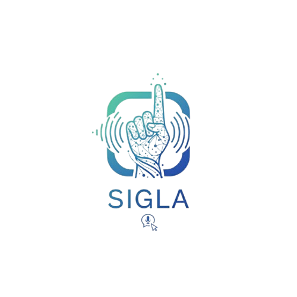

<div align="center">



# SigLa

**A Mobile Sign Language Translator Application for Persons with Speech and/or Hearing Disabilities**

Translate Filipino Sign Language (FSL) gestures into text and speech, entirely on the phone.


[Project Overview](#-project-overview) · [Installation and Setup](#-installation-and-setup) · [Usage Guidelines](#-usage-guidelines)

</div>

---

## 📘 Project Overview

SigLa supports **one-way communication**: a person who signs in Filipino Sign Language is
understood by people who do not. The phone's camera reads the gesture, and the app shows the
translation in English with its Filipino meaning, then speaks it aloud. The aim is to cover
basic, everyday needs at school and at home while relying less on interpreters.

Translation runs **fully offline** on the device. The internet is only needed to download a
newer recognition model, sync the word bank, and download demonstration videos.

### The system at a glance

| Part | What it does | Built with |
|---|---|---|
| **SigLa Mobile** (`sigla-mobile/`) | Camera translation (tap and live modes, words and letters), word bank, translation history, settings, SOS "help me" alert | Kotlin, CameraX, MediaPipe, TensorFlow Lite |
| **Administrator Platform** (`sigla-admin/`) | Web dashboard for super administrators and administrators: words, categories, gesture samples, models, activity logs, reports | React, Vite, Tailwind CSS |
| **Backend Server** (`sigla-backend/`) | REST API that connects the app, the admin platform, the ML service, and the database | Node.js, Express, Sequelize |
| **ML Service** (`sigla-ml/`) | Extracts hand and upper-body landmarks from sign videos, trains and evaluates the recognition models | Python, FastAPI, TensorFlow, MediaPipe |
| **Database and Storage** | Administrator accounts, words, gesture samples, model versions, videos and model files | PostgreSQL and Storage on Supabase |

```text
 Mobile app ──(word bank, model updates)──►  Backend API  ◄──(manage data)── Admin platform
     │                                          │    ▲
     └─ recognizes signs on-device              ▼    │ train / extract
        with a downloaded TFLite model      PostgreSQL + Storage ◄── ML service
```

### Theme

The README follows the same palette as the app and the admin platform.

| Swatch | Role | Hex |
|---|---|---|
|  | Brand navy (mobile primary) | `#13306B` |
|  | Admin blue | `#1E3A8A` |
|  | Light tint | `#EEF3FC` |
|  | Text ink | `#0F1B33` |
|  | Dark mode background ("Tonal Ink") | `#0C1430` |

---

## ⚙️ Installation and Setup

### Requirements

| Tool | Version | Used by |
|---|---|---|
| Node.js and npm | 20.19+ or 22.12+ (required by Vite 7) | Backend, admin platform |
| Python | 3.10 | ML service |
| Android Studio | with Android SDK 34 | Mobile app (runs on Android 7.0+, `minSdk 24`) |
| Supabase project | PostgreSQL + Storage | Database and file storage |

### 1. Clone the repository

```bash
git clone <repository-url> sigla
cd sigla
```

### 2. Database (Supabase)

1. Create a Supabase project and copy its PostgreSQL connection string.
2. Create the Storage buckets for videos, gesture data, and models.
3. Apply the SQL files in `sigla-backend/migrations/` **in order**. See
   [`sigla-backend/migrations/README.md`](sigla-backend/migrations/README.md) for the notes on each one:

   ```bash
   psql "$PG_URI" -f sigla-backend/migrations/001_model_versions_trained_word_ids.sql
   ```

The schema is maintained by hand. The backend never runs `sequelize.sync()`.

### 3. Backend server

```bash
cd sigla-backend
npm install
cp .env.example .env
```

Fill in `.env`. These are the variables the code reads:

| Variable | Purpose |
|---|---|
| `PG_URI` | PostgreSQL / Supabase connection string |
| `PORT` | API port (default `3000`) |
| `JWT_SECRET`, `JWT_EXPIRES_IN` | Login token signing and lifetime |
| `SUPER_ADMIN_USERNAME`, `SUPER_ADMIN_PASSWORD` | The super administrator created on first start |
| `BREVO_API_KEY`, `MAIL_FROM_EMAIL`, `MAIL_FROM_NAME` | Sends six-digit verification and reset codes by email |
| `ML_SERVICE_URL`, `ML_API_KEY` | Address of the ML service and the shared key between the two |
| `SUPABASE_URL`, `SUPABASE_SERVICE_KEY`, `SUPABASE_BUCKET_VIDEOS` | File storage |
| `MIN_SIGNERS_PER_WORD`, `MIN_SAMPLES_PER_SIGNER` | Sample requirements before a word can be trained |
| `ALLOWED_ORIGINS` | Comma-separated admin platform URLs allowed by CORS |

> [!NOTE]
> `.env.example` still lists the old Gmail SMTP variables (`MAIL_USER`, `MAIL_PASS`). Email
> now goes through Brevo, so use `BREVO_API_KEY` and the `MAIL_FROM_*` variables instead.

On first start, the backend creates the **super administrator** from `SUPER_ADMIN_USERNAME`
and `SUPER_ADMIN_PASSWORD`. If those aren't set, it uses `superadmin` / `ChangeMe!123`.

### 4. ML service

```bash
cd sigla-ml
python -m venv venv
venv\Scripts\activate          # macOS/Linux: source venv/bin/activate
pip install -r requirements.txt
cp .env.example .env
```

- Fill in `.env`: `SUPABASE_URL`, `SUPABASE_SERVICE_KEY`, the bucket names, `BACKEND_URL`, and
  `ML_API_KEY`, which must match the backend's. The remaining values tune training. The
  comments in `.env.example` explain each one.
- Download the two MediaPipe model files into `sigla-ml/app/models/`, as described in
  [`sigla-ml/app/models/README.md`](sigla-ml/app/models/README.md).

### 5. Administrator platform

```bash
cd sigla-admin
npm install
cp .env.example .env
```

Set `VITE_API_URL` to the backend's API address, for example `http://localhost:3000/api` (the backend's default port is 3000).

### 6. Mobile app

1. Open the `sigla-mobile/` folder in **Android Studio**.
2. Set `BASE_URL` in `app/build.gradle.kts` to a backend address the phone can reach. It
   currently points to the deployed server, `https://siglaph.online/api/`.
3. Build and run the `app` configuration on a device, or from a terminal:

   ```bash
   cd sigla-mobile
   gradlew.bat assembleDebug      # macOS/Linux: ./gradlew assembleDebug
   ```

Release builds are signed with the credentials in `sigla-mobile/keystore.properties`.

---

## 🚀 Usage Guidelines

### Running everything locally

Open three terminals:

```bash
# Terminal 1: Backend
cd sigla-backend
npm run dev

# Terminal 2: ML service
cd sigla-ml
venv\Scripts\activate
uvicorn app.main:app --reload --port 8000 --host 0.0.0.0

# Terminal 3: Administrator platform
cd sigla-admin
npm run dev
```

Then run the mobile app from Android Studio.

### Administrator platform

| Step | What to do |
|---|---|
| **1. Sign in** | Use the super administrator account. On first login, link an email address with the six-digit code, then change the username and password. |
| **2. Add administrators** | *Manage Administrators* (super administrator only): create accounts and share the credentials. Each new administrator completes the same first-login setup. |
| **3. Set up categories** | *Manage Categories*: add or edit categories such as greeting, family, and food. |
| **4. Add words** | *Manage Words*: add a word with its category, type (word or letter), Filipino translation, and description. |
| **5. Upload gesture samples** | Upload sign videos and pick the signer. The system extracts landmarks in the background. A word needs **20 approved samples from at least 4 signers, with 4 samples each**. |
| **6. Set the demonstration video** | Upload the video the mobile app shows for the word. |
| **7. Train and deploy** | *Manage Model*: train a new version (one words model and one letters model together), check its accuracy, then **Deploy**. Use **Revert** to go back to an earlier version. |
| **8. Monitor** | *Dashboard*, *Activity Logs*, and *Reports* (exports a PDF). |

### Mobile app

| Feature | How to use it |
|---|---|
| **Translate** | Tap the center button. Choose **Tap** (sign on demand) or **Live** (continuous) mode, and **Words** or **Letters**. Sign about 0.5 m from the camera. |
| **SOS** | Hold **SOS** for two seconds to play a "help me" alert. |
| **Word Bank** | Browse categories, search, open a word to watch its demo video, download videos for offline use, and save favorites. |
| **History** | Review past translations (up to 200), delete one, or clear all. |
| **Settings** | Set your name, volume, voice type, and light or dark mode, replay the tutorial, or reset to defaults. |
| **Model updates** | When online, opening the translator checks for a newer model, verifies it, and updates the word bank to match. |

### Tests

```bash
cd sigla-backend && npm test        # backend
cd sigla-ml && pytest               # ML service
```

### Project documentation

| Folder | Contents |
|---|---|
| [`docs-internal/diagrams/`](docs-internal/diagrams/) | Data flow diagrams and ERD (`.drawio`), plus the [scripts that generate them](docs-internal/diagrams/tools/README.md) |
| [`docs-internal/`](docs-internal/) | Scope and delimitation, design specs, and implementation plans |
| [`sigla-backend/migrations/`](sigla-backend/migrations/README.md) | Database migration history |

---

<div align="center">

<sub>SigLa · Filipino Sign Language translation for everyday communication</sub>

</div>
